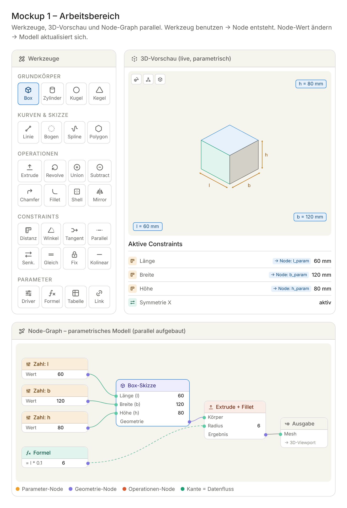
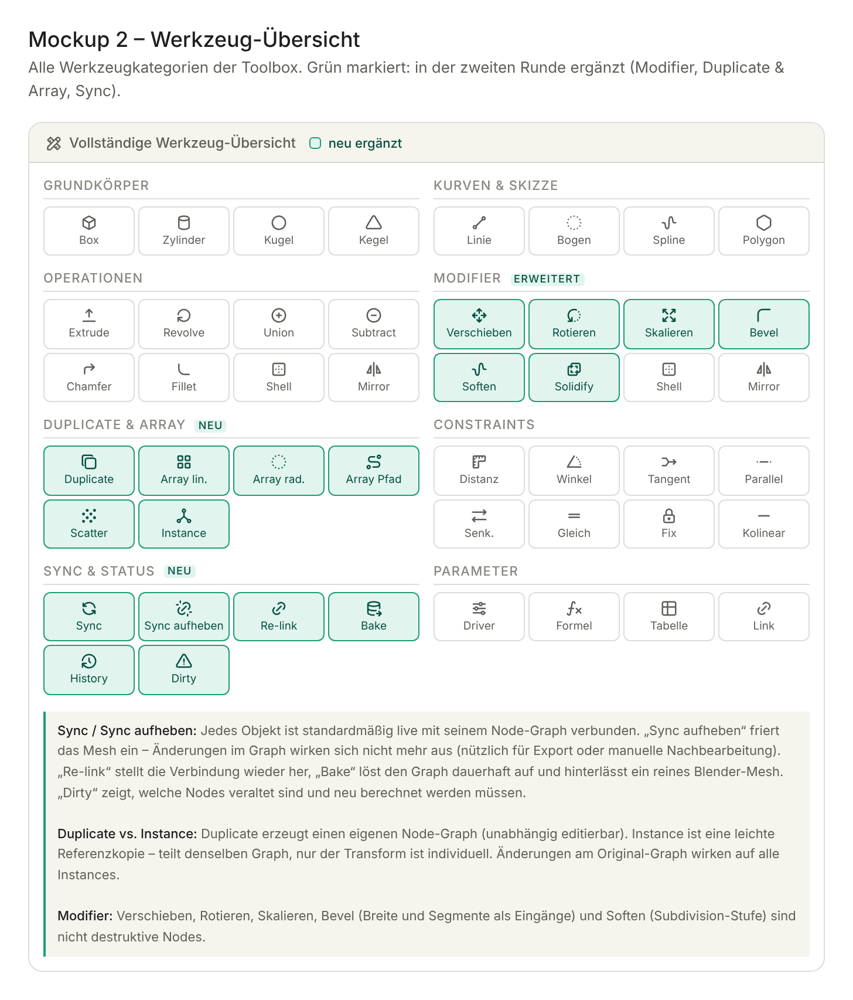
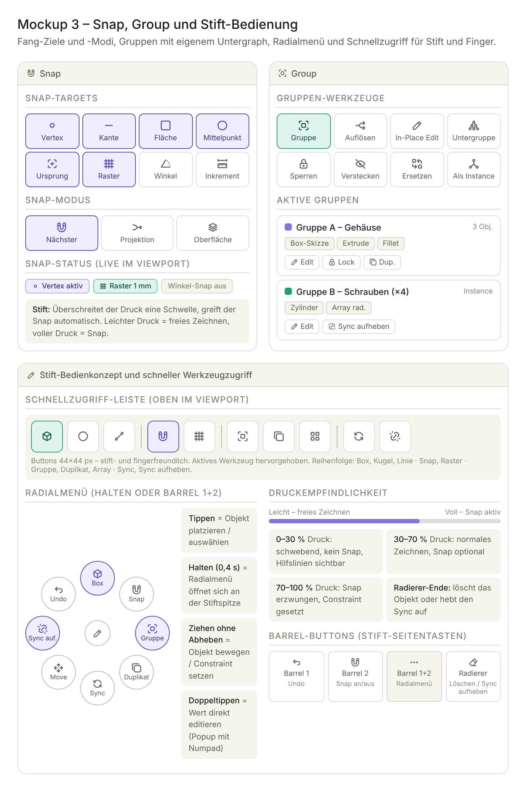

# Mockups zum Konzept

Die drei Skizzen aus dem ursprünglichen Konzeptgespräch. Sie zeigen das **Zielbild** der
Oberfläche. Was davon in welcher Version umgesetzt wird, legt [KONZEPT.md](../KONZEPT.md)
fest. Wo Mockup und Konzept voneinander abweichen, gilt das Konzept.

Jedes Mockup liegt als PNG (zum Ansehen) und als HTML (Quelle mit allen Beschriftungen
als Text) vor. Die HTML-Dateien laden die Icons von einem CDN und brauchen `base.css`
aus diesem Ordner.

## 1 – Arbeitsbereich

Quelle: [01-arbeitsbereich.html](01-arbeitsbereich.html)

- Toolbox links mit fünf Kategorien: Grundkörper, Kurven & Skizze, Operationen, Constraints, Parameter.
- 3D-Vorschau mit Maß-Badges am Objekt (`l`, `b`, `h`) und Liste der aktiven Constraints. Jeder Maß-Constraint zeigt, von welchem Node er gesteuert wird.
- Node-Graph darunter, parallel zum Modell aufgebaut: Parameter-Nodes (Zahl, Formel) → Geometrie-Node (Box) → Operation (Extrude + Fillet) → Ausgabe.

## 2 – Werkzeug-Übersicht

Quelle: [02-werkzeuge.html](02-werkzeuge.html)

- Alle acht Kategorien der Toolbox. Grün markiert sind die später ergänzten Gruppen: Modifier (Verschieben, Rotieren, Skalieren, Bevel, Soften, Solidify), Duplicate & Array (Duplicate, Array linear/radial/Pfad, Scatter, Instance), Sync & Status (Sync, Sync aufheben, Re-link, Bake, History, Dirty).
- Der Hinweiskasten erklärt Sync/Sync aufheben/Re-link/Bake und den Unterschied zwischen Duplicate und Instance.

## 3 – Snap, Group und Stift-Bedienung

Quelle: [03-snap-group-stift.html](03-snap-group-stift.html)

- **Snap:** Ziele (Vertex, Kante, Fläche, Mittelpunkt, Ursprung, Raster, Winkel, Inkrement), Modus (Nächster, Projektion, Oberfläche) und Status-Badges im Viewport.
- **Group:** Werkzeuge (Gruppe, Auflösen, In-Place Edit, Untergruppe, Sperren, Verstecken, Ersetzen, Als Instance) und Gruppenkarten mit Mitgliedern und Aktionen.
- **Schnellzugriff-Leiste** oben im Viewport, Buttons 44×44 px.
- **Radialmenü** mit acht Einträgen: Box, Snap, Gruppe, Duplikat, Sync, Move, Sync aufheben, Undo.
- **Stift:** Gesten (Tippen, Halten, Ziehen, Doppeltippen), Belegung der Seitentasten und des Radierers, Druckstufen für den Snap (0–30 % frei, 30–70 % optional, 70–100 % erzwungen).

## Abweichungen zum Stand 0.2

| Mockup | Stand |
|---|---|
| Geometrische Constraints, freie Skizze (Linie, Bogen), druckabhängiger Snap | umgesetzt in 0.2 |
| Schnellzugriff-Leiste, Radialmenü-Belegung | umgesetzt in 0.2 |
| Spline, Chamfer/Fillet einzelner Kanten, Radierer-Ende, Halten öffnet Radialmenü | geplant für 0.3 |
| Array entlang Pfad, Scatter, Tabellen-Parameter | geplant für 0.3 bzw. später |
| Gruppen sperren/verstecken, Untergruppe, Ersetzen | später, bis dahin über Collections |
| Icons | eigene zweifarbige Icons statt der Tabler-Icons der Mockups, siehe `docs/icons/overview.png` |
| Kacheln | Blender zeichnet Icons auf Buttons fest mit 16 px. Die Kachel besteht deshalb aus großem Icon und dem Button mit der Beschriftung direkt darunter |
